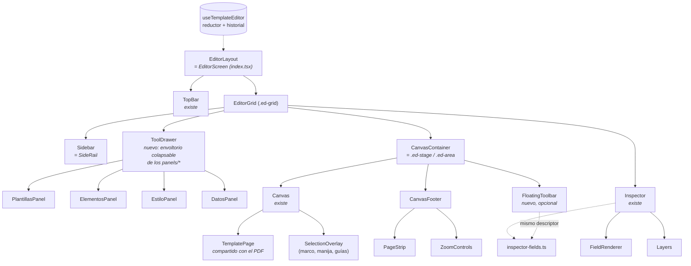

# Mapeo de interfaz tipo editor (referencia: Canva) → Editor de plantillas de Asia-POP

**Estado**: borrador · **Fecha**: 2026-10-14 · **Uso previsto**: entrada para `/speckit-specify` de una futura feature de evolución del editor (`/apariencia`, feature [003](../../specs/003-catalog-template-editor/spec.md))

> ⚠️ **El mapeo en vivo de Canva con REA todavía no se ha ejecutado.** Esta sesión corre en un contenedor en la nube: su
> `127.0.0.1:9222` no es el del computador donde está abierto Vivaldi, y la política de red del contenedor bloquea
> `canva.com`. Por eso este documento separa con cuidado:
>
> - **Medido en Asia-POP**: valores reales leídos del código actual (`frontend/src/pages/TemplateEditor/editor.css`, `frontend/src/styles/theme.css`).
> - **Patrón de referencia**: anatomía general de los editores tipo Canva. Es una hipótesis que hay que confirmar con REA.
> - **⏳ Por medir con REA**: valores de Canva que solo se pueden obtener observando la página. Se llenan con el
>   [runbook de la sección 7](#7-runbook-mapeo-con-rea-en-tu-máquina). **No se inventaron valores de Canva.**

---

## 0. Punto de partida: Asia-POP ya tiene un editor estilo Canva

La feature 003 construyó un editor a pantalla completa con la misma anatomía. Por eso este trabajo **no es una réplica desde cero**: consiste en medir la referencia, encontrar las diferencias y decidir cuáles vale la pena cerrar.

| Zona (Canva) | Hoy en Asia-POP | Archivo |
| --- | --- | --- |
| Barra superior | `TopBar`: ← Menú, vistas Editor/Plantillas, nombre editable, deshacer/rehacer, estado de guardado, Vista previa, Usar, Guardar | `TopBar.tsx` |
| Riel de herramientas | `SideRail`: Plantillas, Elementos, Estilo, Datos (glifos CSS, sin librería de íconos) | `SideRail.tsx` |
| Cajón (*drawer*) | Panel fijo a la derecha del riel; **no se colapsa** | `panels/*.tsx` |
| Barra contextual | **No existe como barra flotante**: las propiedades del elemento viven en el `Inspector` de la derecha | `Inspector.tsx`, `inspector-fields.ts`, `FieldRenderer.tsx` |
| Lienzo | `Canvas` sobre `TemplatePage` (el **mismo** componente que el PDF), selección, manija de esquina, guías al centro | `Canvas.tsx`, `usePointerDrag.ts` |
| Pie del lienzo | `PageStrip` (4 páginas con miniatura) + `ZoomControls` (20–200 %, ajustar) | `PageStrip.tsx`, `ZoomControls.tsx` |
| Capas | Lista de capas con reordenar y bloquear | `Layers.tsx` |
| Reglas | **No existen** | — |

**Diferencias candidatas** (hipótesis que el mapeo debe confirmar o descartar):

1. Barra contextual flotante sobre la selección (Canva) frente a un inspector fijo (Asia-POP).
2. Cajón colapsable con animación frente a un panel fijo.
3. Reglas y guías arrastrables frente a solo guías de centro.
4. Multi-selección, agrupar y rotación con manija: la feature 003 lo dejó fuera a propósito (research §8).
5. Densidad visual: Canva usa chrome neutro (grises) y Asia-POP usa la dirección "Pop" (crema, morado y rosa).

---

## 1. Design tokens

### 1.1 Esquema y valores

Columna **Asia-POP**: valor medido en el código actual. Columna **Canva**: ⏳ pendiente de medir con REA. La decisión de qué tomar de la referencia es de diseño. Recomiendo conservar la **marca** de Asia-POP (colores) y adoptar de la referencia solo la **estructura** (densidad, escala de espaciado, elevación).

#### Color

| Token | Rol | Asia-POP | Canva |
| --- | --- | --- | --- |
| `--ed-bg` | Fondo de la aplicación / área del lienzo | `#fff7ec` | ⏳ |
| `--ed-surface` | Paneles, barra superior | `#ffffff` | ⏳ |
| `--ed-surface-2` | Superficie secundaria (hover de lista, campos) | `#fff1de` | ⏳ |
| `--ed-line` | Bordes y divisores | `#f0dfc8` | ⏳ |
| `--ed-ink` | Texto principal | `#2a1258` | ⏳ |
| `--ed-muted` | Texto secundario, etiquetas | `#7a6a92` | ⏳ |
| `--ed-accent` | Acción primaria, selección activa | `#e5368c` | ⏳ |
| `--ed-accent-hover` | Hover de la acción primaria | `#c41e72` | ⏳ |
| `--ed-selection` | Marco de selección en el lienzo | `#e5368c` (vía `--ed-pink`) | ⏳ |
| `--ed-guide` | Guías de ajuste | `#ff3da8` | ⏳ |
| `--ed-rail-bg` | Fondo del riel lateral | `#2a1258` (`--color-pop-side`) | ⏳ |
| `--ed-rail-active` | Pestaña activa del riel | `#3a1e78` (`--color-pop-side-card`) | ⏳ |
| `--ed-cta-gradient` | Gradiente del botón principal | — (sólido) | ⏳ |

#### Tipografía

| Token | Uso | Asia-POP | Canva |
| --- | --- | --- | --- |
| `--ed-font-ui` | Chrome del editor | `'Nunito Sans'` | ⏳ |
| `--ed-font-display` | Títulos de panel | `'Fredoka'` | ⏳ |
| `--ed-text-base` | Texto por defecto | `13px / 1.4` | ⏳ |
| `--ed-text-sm` | Etiquetas de campo | `12px` | ⏳ |
| `--ed-text-xs` | Kickers, ayudas | `11px` | ⏳ |
| `--ed-text-title` | Título de panel / nombre | `17–18px` | ⏳ |
| `--ed-weight-regular` / `semibold` / `bold` / `heavy` | — | `400 / 600 / 700 / 800` | ⏳ |

#### Espaciado, radios y elevación

| Token | Asia-POP (valores más usados en `editor.css`) | Canva |
| --- | --- | --- |
| Escala de espaciado | `2, 4, 6, 8, 10, 12, 14, 16, 18, 24` px (base 2) | ⏳ (verificar si es base 4 u 8) |
| `--ed-radius-sm` / `md` / `lg` / `pill` | `6 / 8–10 / 12 / 999` px | ⏳ |
| `--ed-shadow-page` | `0 12px 40px rgba(42,18,88,.18)` | ⏳ |
| `--ed-shadow-pop` (menús, toasts) | `0 1px 4px rgba(42,18,88,.25)` | ⏳ |
| `--ed-z-*` | solo `10` usado | ⏳ (pila de capas flotantes) |

### 1.2 Archivo de tokens listo para React + Tailwind v4

El proyecto usa **Tailwind v4** (`@theme` en `frontend/src/styles/theme.css`). Propuesta: un único archivo `frontend/src/styles/editor-tokens.css` con los valores **actuales** de Asia-POP, al que solo se le cambian valores cuando el mapeo lo justifique. Así `editor.css` deja de repetir literales sin cambiar nada visualmente.

```css
/* frontend/src/styles/editor-tokens.css — valores actuales de Asia-POP; ⏳ = revisar contra la referencia */
@theme {
  /* color */
  --color-ed-bg: #fff7ec;
  --color-ed-surface: #ffffff;
  --color-ed-surface-2: #fff1de;
  --color-ed-line: #f0dfc8;
  --color-ed-ink: #2a1258;
  --color-ed-muted: #7a6a92;
  --color-ed-accent: #e5368c;
  --color-ed-accent-hover: #c41e72;
  --color-ed-guide: #ff3da8;
  --color-ed-rail: #2a1258;
  --color-ed-rail-active: #3a1e78;

  /* tipografía */
  --font-ed-ui: 'Nunito Sans', system-ui, sans-serif;
  --font-ed-display: 'Fredoka', system-ui, sans-serif;
  --text-ed-xs: 11px;
  --text-ed-sm: 12px;
  --text-ed-base: 13px;
  --text-ed-title: 17px;

  /* espaciado (base 2 px; ⏳ comprobar si la referencia usa base 4/8) */
  --spacing-ed: 2px; /* p-ed-1 = 2px … p-ed-12 = 24px */

  /* radios */
  --radius-ed-sm: 6px;
  --radius-ed-md: 10px;
  --radius-ed-lg: 12px;

  /* elevación */
  --shadow-ed-page: 0 12px 40px rgba(42, 18, 88, 0.18);
  --shadow-ed-pop: 0 1px 4px rgba(42, 18, 88, 0.25);
}

/* Capas flotantes: un orden explícito evita guerras de z-index (⏳ ajustar a la pila observada) */
:root {
  --z-ed-canvas-overlay: 10; /* selección, manijas, guías */
  --z-ed-drawer: 20;
  --z-ed-floating-toolbar: 30;
  --z-ed-popover: 40; /* menús, selector de color */
  --z-ed-toast: 50;
  --z-ed-modal: 60;
}
```

Y su espejo tipado para usarlo desde TypeScript (por ejemplo para medir en pruebas o en la barra flotante):

```ts
// frontend/src/pages/TemplateEditor/tokens.ts
export const edZ = { overlay: 10, drawer: 20, floatingToolbar: 30, popover: 40, toast: 50, modal: 60 } as const;
export const edSpace = (n: number) => `${n * 2}px`;
```

---

## 2. Anatomía e inventario de componentes

> Patrón de referencia (⏳ por confirmar con REA). Para cada zona, la tabla dice **qué medir** y **cómo lo cubre hoy Asia-POP**.

### 2.1 Barra superior (Top Navigation)

| Elemento | Qué observar en la referencia | Asia-POP |
| --- | --- | --- |
| Menú / volver | Posición, ícono | ✅ ← Menú |
| Título editable | Inline (clic → input), validación, ancho máx. | ✅ `ed-name` con error inline |
| Deshacer / rehacer | Estado deshabilitado, atajos, tooltip | ✅ 60 pasos, Ctrl+Z / Ctrl+Mayús+Z / Ctrl+Y |
| Estado de guardado | Autoguardado vs. manual, indicador | ✅ manual + punto de estado |
| Compartir / Descargar | Botón primario con menú desplegable de formatos | ⚠️ "Guardar" y "Usar"; el PDF se genera en otra pantalla (Generar) |

### 2.2 Riel lateral y cajón (Toolbox / Sidebar + Drawer)

| Elemento | Qué observar | Asia-POP |
| --- | --- | --- |
| Riel de pestañas | Ancho, ícono + etiqueta, estado activo | ✅ 4 pestañas con glifos CSS |
| Cajón | Ancho, ¿se colapsa al volver a pulsar la pestaña activa?, animación (duración/easing), ¿empuja o superpone el lienzo? | ⚠️ siempre abierto |
| Búsqueda en el cajón | Campo arriba, filtros | ❌ (no hace falta con ~4 plantillas y pocos elementos) |
| Contenido | Grilla de miniaturas, elementos arrastrables al lienzo | ⚠️ se agregan con clic, no arrastrando |

### 2.3 Barra contextual (Contextual Action Bar)

| Elemento | Qué observar | Asia-POP |
| --- | --- | --- |
| Ubicación | Fija bajo la barra superior o flotante sobre la selección | Inspector fijo a la derecha |
| Contenido por tipo | Texto: fuente, tamaño, color, alineación; Forma: relleno, borde; Imagen: recorte, filtros; Común: posición, transparencia, capas | ✅ dirigido por datos (`inspector-fields.ts`): agregar una propiedad es agregar una línea |
| Desbordamiento | Qué pasa con poco ancho (menú "…") | ✅ `ed-overflow` |

**Decisión de arquitectura clave**: `inspector-fields.ts` ya es un **modelo de datos de la barra contextual**. Una barra flotante es solo **otra vista** (`FloatingToolbar`) del mismo descriptor, así que no hace falta duplicar lógica.

### 2.4 Lienzo (Canvas Viewport)

| Elemento | Qué observar | Asia-POP |
| --- | --- | --- |
| Contenedor | Scroll vs. pan, fondo, márgenes alrededor de la página | ✅ ajustar con `AREA_PAD = 24` px, `ResizeObserver` |
| Página | Sombra, radio, escala | ✅ `TemplatePage` (compartido con el PDF) |
| Selección | Color/grosor del marco, manijas (cuántas, forma), manija de rotación | ⚠️ marco + 1 manija de esquina, sin rotación con manija |
| Guías | Centro, bordes, entre elementos; color | ⚠️ solo centro (tolerancia 1,2 % / 0,9 %) |
| Reglas | ¿Existen?, unidades | ❌ |
| Pie: páginas y zoom | Miniaturas, añadir página, slider/porcentaje | ✅ 4 páginas fijas + zoom 20–200 % |

---

## 3. Jerarquía de componentes React

Nombres propuestos (izquierda) mapeados a lo existente (derecha). **Solo los marcados como _nuevo_ requerirían código.**



**Capas (Clean Architecture, lo que ya se cumple y debe conservarse):**

| Capa | Contenido | Regla |
| --- | --- | --- |
| Dominio | `backend/src/catalog/template.ts` (tipos, `LIMITS`, `RANGES`), `template-presets.ts`, `theme.ts` | Puro, sin React. Compartido con el backend |
| Aplicación | `useTemplateEditor` (reductor, historial de 60 pasos, fusión en 800 ms), `inspector-fields.ts` | No conoce el DOM |
| Presentación | `TopBar`, `SideRail`, `panels/*`, `Inspector`, `Canvas`… | Solo dibuja y despacha acciones |
| Render | `TemplatePage` | **Único** para editor, miniaturas, vista previa y PDF (constitución IV) |

---

## 4. Estados e interacciones a observar

| Interacción | Qué capturar con REA | Asia-POP hoy |
| --- | --- | --- |
| Abrir un menú desplegable | Clases/atributos que cambian (`aria-expanded`, `data-state`), si el menú se monta en un *portal*, z-index, animación | `ed-overflow` |
| Colapsar la barra lateral | Cambio de ancho del cajón, transición (duración/easing), si el lienzo se reajusta | no aplica (fijo) |
| Seleccionar un bloque | Qué nodos aparecen (marco, manijas), cómo cambia la barra contextual, foco del teclado | marco + manija; el inspector cambia de campos |
| Arrastrar | Guías que aparecen, ajuste (snap) y su tolerancia, cursor | guías al centro, `usePointerDrag` |
| Hover | Colores de hover en riel, botones y miniaturas | ver `editor.css` |
| Teclado | Atajos, foco visible, `Esc` | FR-008 de 003 |

---

## 5. Librerías propuestas

Criterio: la constitución **VI (Simplicidad)** y la research §8 de 003 ya descartaron librerías de arrastre, color, historial y estado global. Cualquier librería nueva tiene que justificar una necesidad nueva.

| Librería | Veredicto | Motivo |
| --- | --- | --- |
| **Tailwind CSS v4** | ✅ Ya instalada | Mover los literales de `editor.css` a los tokens de §1.2 |
| **Lucide (`lucide-react`)** | ✅ Recomendada | Íconos SVG con *tree-shaking* y licencia ISC. Reemplaza los glifos CSS del riel y da íconos claros a deshacer/rehacer, alineación y capas. Bajo costo y gran mejora de legibilidad |
| **Radix UI Primitives** (`@radix-ui/react-popover`, `-dropdown-menu`, `-tooltip`) | 🟡 Solo si se hace la barra flotante o los menús | Resuelven lo difícil de verdad: posicionamiento con colisiones, *portal*, foco atrapado, `Esc`, `aria-*`. Se instalan por primitiva y sin estilos, así que encajan con Tailwind. No hacen falta para el inspector actual |
| **DnD Kit** (`@dnd-kit/core`, `/sortable`) | 🟡 Solo para **listas** | Útil para reordenar **capas** o **páginas** arrastrando, o para soltar elementos del cajón en el lienzo. **No** para mover elementos dentro del lienzo: ahí `usePointerDrag` con coordenadas en % y zoom es más simple y ya funciona |
| **Konva / react-konva / Fabric.js** (lienzo HTML5 Canvas) | ❌ No recomendada | Rompería la constitución IV. Hoy **editor y PDF dibujan con el mismo componente DOM** (`TemplatePage` → Puppeteer). Un lienzo en `<canvas>` obligaría a mantener dos renderizadores y a perder la garantía "lo que ves es el PDF". Solo tendría sentido con miles de objetos, y el límite es de 60 por página |
| `react-moveable` | 🟡 Reevaluar solo si se piden rotación con manija, multi-selección o grupos | Es exactamente el disparador que dejó escrito la research §8 |
| Zustand / Redux | ❌ | Un reductor local alcanza |

---

## 6. Propuesta de alcance (para `/speckit-specify`)

En orden de valor/costo:

1. **Tokens** (§1.2): refactor sin cambio visual. Prueba: capturas antes y después idénticas.
2. **Íconos Lucide** en el riel y la barra superior.
3. **Cajón colapsable** (`ToolDrawer`): más espacio para el lienzo en 1366×768.
4. **Barra contextual flotante** (`FloatingToolbar` + Radix Popover) reutilizando `inspector-fields.ts`; el inspector queda para propiedades avanzadas.
5. Opcional: reordenar capas o páginas con DnD Kit; reglas.

Fuera de alcance: lienzo `<canvas>`, colaboración en tiempo real, autoguardado.

---

## 7. Runbook: mapeo con REA en tu máquina

Requiere Claude Code **corriendo localmente** (no en la nube), en el mismo computador que Vivaldi.

```bash
# 1. Vivaldi con CDP (cerrar otras instancias antes)
vivaldi --remote-debugging-port=9222 --user-data-dir="$HOME/.vivaldi-rea"
#    Windows: "C:\Users\<tú>\AppData\Local\Vivaldi\Application\vivaldi.exe" --remote-debugging-port=9222 --user-data-dir=C:\tmp\vivaldi-rea

# 2. Comprobar que responde
curl http://127.0.0.1:9222/json/version

# 3. Registrar REA en Claude Code y reiniciarlo
npx rea-agents setup
```

Prompt sugerido para Claude Code local:

> Usa REA (`list_browser_targets`, `capture_web_screenshot`, `inspect_web_page` con `include_script_sources: false`) sobre la pestaña del editor de Canva en `http://127.0.0.1:9222`. Llena **solo** las celdas ⏳ de `docs/specs/canva-ui-mapping.md` con valores observados y su evidencia (selector o captura). Repite la captura en tres estados: nada seleccionado, texto seleccionado y menú desplegable abierto, y compáralas con `compare_web_captures`. No analices ni recuperes sus scripts.

**Por qué funciona así, desde la IA**: el modelo no "ve" la pantalla directamente. REA le entrega tres fuentes: la **captura** (visión), el **DOM y el árbol de accesibilidad** (estructura) y los **estilos computados** (valores exactos). La captura sirve para entender la composición; los valores salen del DOM, no de "leer" píxeles. Pedirle evidencia por cada valor es lo que evita que el modelo rellene huecos con suposiciones.

**Límites de uso**: observar la interfaz renderizada (lo mismo que DevTools) para extraer patrones de diseño está bien para un caso de estudio. No copies los assets, íconos, logotipos ni el código JS de Canva: sus términos prohíben la ingeniería inversa del servicio. Lo que llega a Asia-POP son **patrones y estructura con su propia marca**, no la de Canva.
